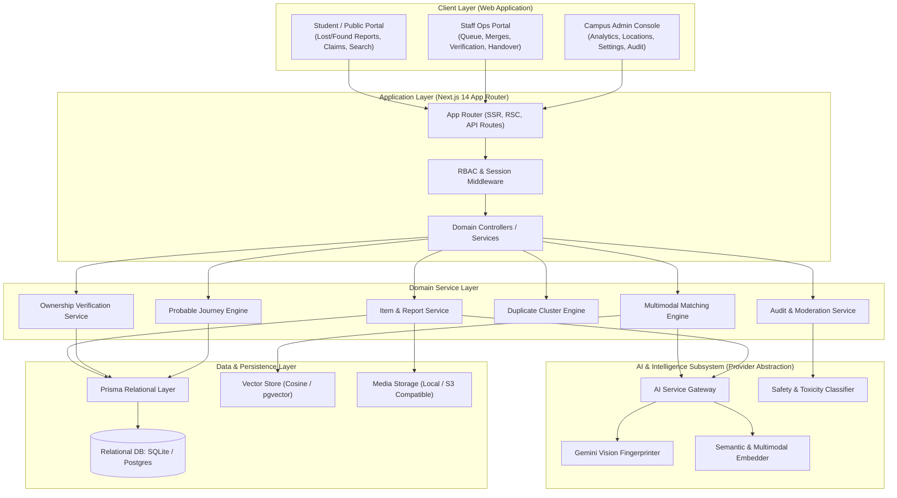

# UniTrace — System Architecture Document

## 1. Executive Overview

**UniTrace** is an enterprise-grade, AI-powered lost-and-found intelligence platform designed for large campus ecosystems (universities, corporate campuses, research institutes, airports, and residential campuses). 

Unlike legacy lost-and-found databases that rely on rigid keyword matches and static catalogs, UniTrace is built upon a **multimodal matching engine** that harmonizes:
1. **High-dimensional visual embeddings and structured visual fingerprints** (logos, textures, unique scratches, stickers, condition).
2. **Semantic language understanding** bridging heterogeneous phrasing (e.g., *"black laptop sleeve with red mark"* matches *"dark computer case with crimson sticker"*).
3. **Spatio-temporal graph modeling** (campus proximity decay, building/room topography, time compatibility).
4. **Probable Item Journey reconstruction** with explicit differentiation between **OBSERVED** and **AI-INFERRED** transitions.
5. **Zero-Knowledge Ownership Verification** preventing fraudulent claims of high-value items.
6. **Multi-Tenant SaaS Foundation** supporting multiple institutions, campuses, sub-locations, and role-based operational hierarchies.

---

## 2. High-Level Architecture Topology



---

## 3. Technology Stack Specification

| Tier | Technology | Rationale & Selection Criteria |
| :--- | :--- | :--- |
| **Frontend Framework** | **Next.js 14 (App Router) + React 18** | Industry-standard SSR/RSC hybrid framework offering instant client transitions, optimized image pipeline, and secure server-side execution for APIs. |
| **Language** | **TypeScript 5 (Strict Mode)** | End-to-end type safety across domain models, API payloads, and AI extraction contracts. |
| **Styling & UI System** | **Tailwind CSS + Lucide Icons** | Design-system-first utility CSS enabling a clean, modern, institutional SaaS aesthetic without excessive bloated component libraries. |
| **Persistence / ORM** | **Prisma ORM** | Type-safe query generation, reliable relational migrations, and flexible backend dialect compatibility. |
| **Database Engines** | **PostgreSQL (Prod) / SQLite (Dev & Zero-Setup)** | Designed with 100% standard ANSI relational schema. Supports instant development out of the box while seamlessly promoting to PostgreSQL + `pgvector` in production environments. |
| **AI Vision & LLM** | **Google Gemini (gemini-1.5-flash / gemini-2.5)** | State-of-the-art visual understanding, zero-shot structured JSON extraction for visual fingerprints, and rich semantic context comprehension. |
| **Embeddings** | **Gemini Embeddings (`text-embedding-004`)** | High-dimensional dense vector embeddings with abstraction layer supporting fallback vector cosine mathematics. |
| **Testing Suite** | **Vitest** | Blazing-fast unit and integration test runner with native ESM and TypeScript support. |
| **Security & Auth** | **Session Tokens + SHA-256 Hashes + Bcrypt** | Secure HTTP-only cookies, timing-safe hash comparisons, role-based route interceptors. |

---

## 4. Layered Directory & Code Organization

```
code flux/
├── app/                              # Next.js App Router (UI Pages & API Endpoints)
│   ├── (auth)/                       # Authentication routes (login, register, logout)
│   ├── (public)/                     # Public pages (landing, how-it-works, about)
│   ├── (user)/                       # Student/General User workflows
│   │   ├── dashboard/                # Active lost/found tracking & instant matches
│   │   ├── report/lost/              # Multi-step lost item reporting
│   │   ├── report/found/             # Found item intake
│   │   ├── search/                   # Multimodal natural language search
│   │   ├── match/[id]/               # Side-by-side match breakdown & evidence
│   │   ├── journey/[id]/             # Interactive probable item timeline
│   │   ├── claims/                   # Claim tracking & verification submissions
│   │   └── notifications/            # Alerts & updates
│   ├── staff/                        # Staff portal
│   │   ├── dashboard/                # Operational queues & KPI badges
│   │   ├── queue/                    # Incoming unreviewed reports
│   │   ├── clusters/                 # Duplicate report review & merge actions
│   │   ├── claims/                   # Ownership verification evaluation
│   │   └── handover/                 # Secure release & audit log signoff
│   ├── admin/                        # Campus Administration
│   │   ├── dashboard/                # Executive analytics, recovery rate, heatmaps
│   │   ├── locations/                # Campus zones, buildings, geo-coordinates
│   │   ├── categories/               # Item taxonomy & custom verification prompts
│   │   └── audit/                    # Immutable system audit trail
│   └── api/                          # REST/JSON API Endpoints
│       ├── auth/                     # Session & identity endpoints
│       ├── items/                    # CRUD & upload processing
│       ├── match/                    # On-demand match calculation & candidate retrieval
│       ├── journey/                  # Sighting registration & timeline computation
│       ├── claims/                   # Verification submission & review
│       ├── duplicates/               # Clustering & merge endpoints
│       └── admin/                    # Administrative management & metrics
├── components/                       # Shared UI Components
│   ├── ui/                           # Atoms (buttons, inputs, modal, cards, badges)
│   ├── map/                          # Campus map visualizer & trajectory paths
│   ├── visual-fingerprint/           # Structured attribute breakdown card
│   ├── match-evidence/               # Side-by-side comparison & confidence bars
│   └── timeline/                     # Sighting sequence (Observed vs Inferred)
├── lib/                              # Core Domain & Application Services
│   ├── ai/                           # AI & Vector Abstraction Layer
│   │   ├── ai-service.ts             # Gateway interface
│   │   ├── gemini-provider.ts        # Gemini API integration (vision + embed)
│   │   ├── mock-provider.ts          # Deterministic offline provider for tests
│   │   ├── fingerprint.ts            # Visual attribute schema & extractor
│   │   └── vector-store.ts           # Cosine similarity & vector index adapter
│   ├── matching/                     # Multimodal Scoring Engine
│   │   ├── scorer.ts                 # Configurable multi-signal weight calculator
│   │   ├── evidence.ts               # Human-readable justification builder
│   │   └── weights.ts                # Tunable weighting configuration
│   ├── journey/                      # Item Journey Engine
│   │   ├── tracker.ts                # Sighting aggregator
│   │   └── inference.ts              # Spatio-temporal path interpolator
│   ├── duplicates/                   # Duplicate Clustering Engine
│   │   ├── clusterer.ts              # Graph / threshold-based cluster detector
│   │   └── merger.ts                 # Safe traceable merge executor
│   ├── claims/                       # Ownership Verification Engine
│   │   ├── verification.ts           # Question evaluation & privacy filter
│   │   └── handover.ts               # Handover dispatch & PIN verification
│   ├── auth.ts                       # Session management & RBAC helpers
│   ├── prisma.ts                     # Prisma client singleton
│   ├── validators.ts                 # Zod validation schemas
│   └── audit.ts                      # Standardized audit event logger
├── prisma/
│   ├── schema.prisma                 # Normalized multi-tenant relational schema
│   ├── migrations/                   # Migration versions
│   └── seed.ts                       # Comprehensive demo storyline & campus dataset
├── tests/                            # Automated Test Suites
│   ├── unit/                         # Scorer, fingerprint, and verification unit tests
│   ├── integration/                  # API routes & database operations
│   └── e2e/                          # Full demo storyline browser tests
└── docs/                             # Engineering & Operational Documentation
```

---

## 5. Multi-Tenant SaaS Architecture

UniTrace isolates data across institutional boundaries:
1. **`Institution` Model**: Top-level tenant (e.g., "Apex University", "Skyport Metro Airport").
2. **`Campus` Model**: Geographically discrete sites within an institution (e.g., "North Campus", "South Tech Hub").
3. **`Location` Model**: Physical entities with hierarchical resolution: `Building -> Floor -> Zone/Room`, tagged with geographic latitude/longitude.
4. **Tenant Isolation Strategy**: Every user, item, report, sighting, claim, and audit record is anchored to an `institutionId`. Data access queries are strictly scoped by tenant in domain service gateways.
