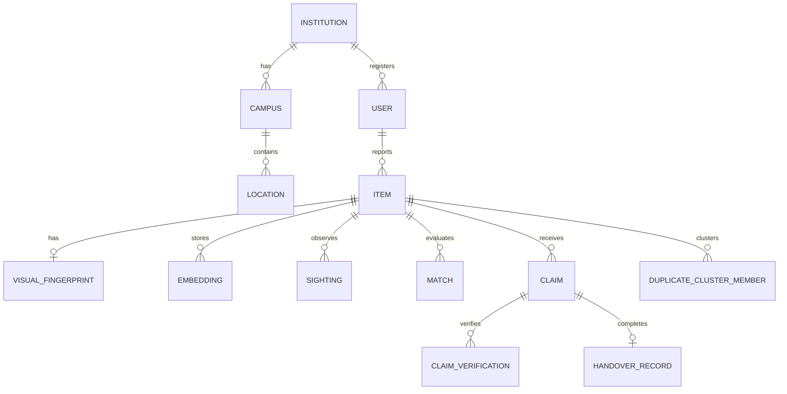

# UniTrace — Database Architecture & Schema Specification

## 1. Overview

UniTrace uses a fully normalized, relational data model engineered for high query efficiency, auditability, and multi-tenancy. 

The schema accommodates:
* Multi-tenant institutions, campuses, and physical locations with geo-coordinates.
* Dual reporting workflows: `LostReport` and `FoundReport` mapped to unified `Item` entities.
* Structured `VisualAttribute` fingerprints with granular confidence ratings.
* Dense multimodal and text `Embedding` vectors.
* Weighted `Match` candidate relations with detailed explainable `MatchEvidence`.
* Incremental `Sighting` checkpoints tracking observed and inferred journeys.
* `Claim` workflows with multi-step `ClaimVerification` and `HandoverRecord`.
* `DuplicateCluster` grouping for deduplication with audit traceability.
* Comprehensive `AuditLog` and `Notification` streams.

---

## 2. Entity-Relationship Model (Relational Specification)

---

## 3. Core Database Models

### `Institution` & `Campus` & `Location`
* **`Institution`**: Primary multi-tenant boundary (`id`, `name`, `slug`, `domain`, `settingsJson`, `createdAt`, `updatedAt`).
* **`Campus`**: Sub-institution site (`id`, `institutionId`, `name`, `code`, `centerLat`, `centerLng`).
* **`Location`**: Pinpoint campus location (`id`, `campusId`, `name`, `building`, `floor`, `roomOrArea`, `latitude`, `longitude`, `isSecurityDesk`).

### `User` & `Session`
* **`User`**: (`id`, `institutionId`, `email`, `name`, `passwordHash`, `role` [STUDENT, STAFF, ADMIN, SUPER_ADMIN], `phone`, `avatarUrl`, `isVerified`, `isActive`, `createdAt`).
* **`Session`**: (`id`, `userId`, `tokenHash`, `expiresAt`, `createdAt`).

### `Category` & `Item`
* **`Category`**: (`id`, `institutionId`, `name`, `slug`, `icon`, `isHighValue`, `verificationSchemaJson`).
* **`Item`**: Core entity (`id`, `institutionId`, `reporterId`, `type` [LOST, FOUND], `title`, `description`, `categoryId`, `primaryLocationId`, `incidentDate`, `incidentTime`, `status` [ACTIVE, MATCH_PENDING, UNDER_VERIFICATION, RECOVERED, CLOSED, ARCHIVED], `moderationStatus` [APPROVED, PENDING_REVIEW, FLAGGED, REJECTED], `isHighValue`, `isDuplicate`, `primaryItemId`, `createdAt`, `updatedAt`).
* **`ItemImage`**: (`id`, `itemId`, `url`, `thumbnailUrl`, `isPrimary`, `width`, `height`, `createdAt`).

### `VisualFingerprint`
* **`VisualFingerprint`**:
  * `id`: string
  * `itemId`: string (foreign key to `Item`)
  * `category`: string
  * `subcategory`: string?
  * `primaryColor`: string
  * `secondaryColors`: string (JSON array)
  * `shape`: string?
  * `material`: string?
  * `brand`: string?
  * `visibleText`: string?
  * `logo`: string?
  * `stickers`: string?
  * `scratches`: string?
  * `dents`: string?
  * `uniqueMarks`: string?
  * `accessories`: string?
  * `approximateSize`: string?
  * `condition`: string?
  * `confidenceScores`: string (JSON key-value mapping of attribute confidences)
  * `rawAiResponse`: string? (audit trail of vision model output)

### `Embedding` (Vector Representation)
* **`Embedding`**:
  * `id`: string
  * `itemId`: string
  * `type`: string (`TEXT_SEMANTIC`, `MULTIMODAL_VISION`, `ATTRIBUTES_COMPOUND`)
  * `vector`: string (serialized JSON float array for SQLite/abstract store, or `vector(768)` in PostgreSQL)
  * `model`: string (`text-embedding-004`, `multimodal-gemini`)
  * `dimensions`: integer (768)

### `Match` & `MatchEvidence`
* **`Match`**:
  * `id`: string
  * `lostItemId`: string
  * `foundItemId`: string
  * `overallScore`: float (0.0 to 1.0)
  * `visualScore`: float
  * `semanticScore`: float
  * `attributeScore`: float
  * `locationScore`: float
  * `timeScore`: float
  * `status`: string (`POTENTIAL`, `REVIEWED_BY_STAFF`, `CONFIRMED`, `DISMISSED`)
  * `confidenceTier`: string (`LOW`, `MEDIUM`, `HIGH`, `EXCEPTIONAL`)
  * `createdAt`: timestamp
* **`MatchEvidence`**:
  * `id`: string
  * `matchId`: string
  * `signalType`: string (`CATEGORY_MATCH`, `COLOR_AGREEMENT`, `STICKER_FINGERPRINT`, `SPATIAL_PROXIMITY`, `TEMPORAL_COMPATIBILITY`, `SEMANTIC_ALIGNMENT`)
  * `description`: string
  * `score`: float
  * `weight`: float

### `Sighting` (Probable Journey Timeline)
* **`Sighting`**:
  * `id`: string
  * `itemId`: string
  * `locationId`: string
  * `timestamp`: timestamp
  * `sightingType`: string (`OBSERVED`, `AI_INFERRED`)
  * `confidence`: float (e.g. 1.0 for direct observed, 0.75 for inferred transit)
  * `reportedBy`: string? (reporter / staff)
  * `notes`: string?
  * `sequenceOrder`: integer

### `Claim` & `ClaimVerification` & `HandoverRecord`
* **`Claim`**:
  * `id`: string
  * `itemId`: string (Found item being claimed)
  * `claimantId`: string
  * `lostItemId`: string? (Reference to lost report if linked)
  * `status`: string (`PENDING`, `UNDER_REVIEW`, `VERIFICATION_REQUIRED`, `VERIFIED`, `HANDOVER_SCHEDULED`, `COMPLETED`, `REJECTED`, `CANCELLED`, `EXPIRED`)
  * `verificationLevel`: string (`STANDARD`, `HIGH_VALUE_STRICT`)
  * `rejectionReason`: string?
  * `createdAt`: timestamp
  * `updatedAt`: timestamp
* **`ClaimVerification`**:
  * `id`: string
  * `claimId`: string
  * `question`: string
  * `claimantAnswer`: string (encrypted / private)
  * `isCorrect`: boolean?
  * `reviewerNotes`: string?
  * `evidenceFiles`: string? (JSON array of uploaded receipts/proof photos)
* **`HandoverRecord`**:
  * `id`: string
  * `claimId`: string
  * `staffUserId`: string
  * `handoverCode`: string (one-time security verification PIN)
  * `handoverLocationId`: string
  * `releasedAt`: timestamp
  * `idVerificationMethod`: string (`STUDENT_ID_CARD`, `GOVT_ID`, `STAFF_ATTESTATION`)
  * `claimantSignature`: string? (signed confirmation token)
  * `notes`: string?

### `DuplicateCluster` & `DuplicateClusterMember`
* **`DuplicateCluster`**:
  * `id`: string
  * `institutionId`: string
  * `canonicalItemId`: string? (the primary merged record)
  * `status`: string (`SUGGESTED`, `MERGED`, `DISMISSED`)
  * `averageSimilarity`: float
  * `detectedAt`: timestamp
* **`DuplicateClusterMember`**:
  * `clusterId`: string
  * `itemId`: string
  * `similarityToCanonical`: float

### `AuditLog` & `Notification`
* **`AuditLog`**:
  * `id`: string
  * `institutionId`: string
  * `actorId`: string?
  * `action`: string (e.g., `ITEM_CREATED`, `CLAIM_APPROVED`, `ITEMS_MERGED`, `HANDOVER_COMPLETED`)
  * `entityType`: string
  * `entityId`: string
  * `metadata`: string? (JSON state delta)
  * `ipAddress`: string?
  * `createdAt`: timestamp
* **`Notification`**:
  * `id`: string
  * `userId`: string
  * `type`: string (`MATCH_FOUND`, `CLAIM_UPDATE`, `VERIFICATION_REQUEST`, `HANDOVER_READY`, `SECURITY_ALERT`)
  * `title`: string
  * `message`: string
  * `actionUrl`: string?
  * `readAt`: timestamp?
  * `createdAt`: timestamp

---

## 4. Indexing Strategy

* `@@index([institutionId, status, createdAt])` on `Item` for fast dashboard queries.
* `@@index([categoryId, primaryLocationId])` on `Item` for candidate retrieval filtering.
* `@@index([lostItemId, foundItemId])` on `Match` with unique constraint to prevent duplicate match rows.
* `@@index([itemId, sequenceOrder])` on `Sighting` for timeline reconstruction.
* `@@index([userId, readAt, createdAt])` on `Notification` for alert badges.
* `@@index([entityType, entityId, createdAt])` on `AuditLog` for rapid compliance audit inspection.
